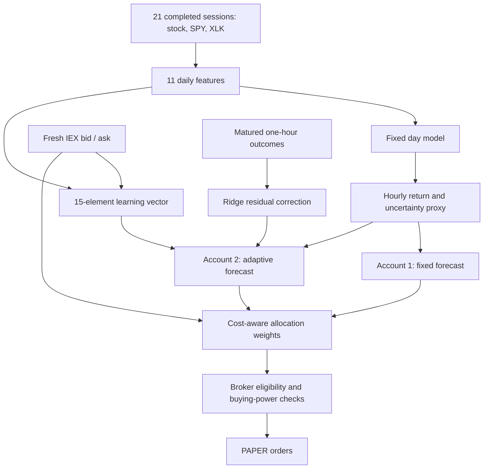

<div align="center">

# Mainkraft

**Quantitative Research · Machine Learning · Experimental Paper Trading**

An independent quantitative research platform for source-backed company analysis, reproducible forecasting, adaptive learning, and isolated PAPER-only trading experiments.


[Overview](#project-overview) · [Quantitative models](#quantitative-models) · [Rust research](#rust-strategy-research) · [Getting started](#getting-started)

[Forecasting research](#forecasting-research) · [Legacy PAPER strategies](#legacy-paper-strategies) · [Pilot history](#paper-trading-pilot) · [Operations](#deployment-and-operations) · [Documentation](#documentation)

</div>

---

## Project overview

Mainkraft combines **Next.js**, **FastAPI**, and **PostgreSQL** with a prospective, append-only forecast ledger and an isolated experimental PAPER-only execution environment.

| Component | Scope | Status |
| :--- | :--- | :--- |
| Company research | MSI, AXON | Frozen research |
| Two-account experiment | Fixed reference vs. adaptive residual learning | Last observed enabled Nov 18, 2026; live status unverified |
| Initial paper pilot | AMD, MSFT, GOOG, AMZN, TSM, META | Historical separate paper account |
| Rust signal research | Trend, Breakout, Mean Reversion, Pullback, Momentum | Implemented; not broker-activated |
| Benchmark | SPY | Reference |
| Prospective shadow | Histogram boosting / market context | Experimental, not validated |
| Vision models | Two pinned chart models | Licensing review required |

The Day, Swing and Challenger policies and initial results are documented in [Mainkraft paper pilot](docs/mainkraft-paper-pilot.md).

> [!IMPORTANT]
> The existing KefTrade repository and production services are not part of this application. **Never inspect, modify, delete, move, prune, or restart anything belonging to `/home/ubuntu/minecraft`, its services, volumes, containers, or backups.** No VPS cleanup is required or provided.

## Research at a glance

| Phase | Evidence | Result |
| :--- | :--- | :--- |
| Phase 2 | 36 experiments · 7,092 retained predictions | No candidate established improvement |
| Phase 3 | 80 Optuna trials · 40 evaluated candidates | No corrected diagnostic interval demonstrated improvement |
| Prospective shadow | First eligible origin: November 16, 2026 | Final comparison requires 126 paired dates and matured outcomes |
| Paper pilot v4 | 40 screened candidates; cost-planning gate | Historical experimental path; numerical challenger disabled |
| `paper-learning-v1` | Two-account comparison; one-trading-hour outcomes | Experimental; no validated return edge |

> [!NOTE]
> The project does not claim a validated return edge. Paper-trading probability estimates are not demonstrated accuracy, and no real-money execution is included.

## Quantitative models

### `paper-learning-v1` — two-account experiment

> [!IMPORTANT]
> **Deployment evidence:** the latest supplied saved service observation is November 18, 2026 (Pacific time). It reports `paper-learning-v1` enabled with two PAPER accounts. The live server state on November 26, 2026 is unverified. When `paper_experiment_enabled` is enabled, the two-account engine runs instead of the legacy `paperpilot.engine`. The coefficient snapshot below is a separately dated local model bundle; the November 18 observation alone does not establish which exact bundle was running then.

| | Account 1 — fixed reference | Account 2 — adaptive experiment |
| :--- | :--- | :--- |
| Starting model | Fixed day model | Same fixed day model |
| Hourly forecast | Unadjusted proxy | Ridge residual correction |
| Learning | None | All available matured forecast outcomes |
| Allocation perturbation | None | Reproducible Gaussian noise |
| Rebalance interval | 5 minutes | 5 minutes |
| Execution | PAPER only | PAPER only |



Sources: [service.py](apps/api/paperpilot/service.py#L169), [saved deployment status](reports/paper-learning/deployed-status.json), [experiment deployment notes](reports/paper-learning/README.md).

**Mathematical reference:** [Features](#01--daily-feature-engineering) · [Fixed model](#02--fixed-return-model-and-probability-calibration) · [Hourly proxy](#03--intraday-forecast-proxy) · [Adaptive learning](#04--adaptive-learning-from-matured-outcomes) · [Allocation](#05--portfolio-allocation-and-position-sizing) · [Execution](#06--execution-constraints-and-limitations)

### 01 · Daily feature engineering

Use 21 completed trading sessions before the current session. Let $t$ be the most recent completed session, $P$ the stock close, $S$ the SPY close, $T$ the XLK close, and $V$ stock volume. Define daily returns as

$$
r_i=\frac{P_i}{P_{i-1}}-1.
$$

| Feature | Meaning |
| :--- | :--- |
| $x_0,x_1,x_2,x_3$ | 1-, 5-, 10- and 20-session stock returns |
| $x_4,x_5$ | 10- and 20-session return volatility |
| $x_6$ | Volume relative to the previous 20 sessions |
| $x_7,x_8$ | 5- and 20-session SPY returns |
| $x_9$ | XLK minus SPY, 5-session return |
| $x_{10}$ | Stock minus SPY, 5-session return |

$$
\begin{aligned}
x_0 &= P_t/P_{t-1}-1, & x_1 &= P_t/P_{t-5}-1,\\
x_2 &= P_t/P_{t-10}-1, & x_3 &= P_t/P_{t-20}-1,\\
x_4 &= \operatorname{std}(r_{t-9},\ldots,r_t),\\
x_5 &= \operatorname{std}(r_{t-19},\ldots,r_t),\\
x_6 &= \frac{V_t}{\operatorname{mean}(V_{t-20},\ldots,V_{t-1})},\\
x_7 &= S_t/S_{t-5}-1, & x_8 &= S_t/S_{t-20}-1,\\
x_9 &= (T_t/T_{t-5}-1)-x_7,\\
x_{10} &= x_1-x_7.
\end{aligned}
$$

Standard deviation uses NumPy's population convention (division by $N$, not $N-1$). Annualized volatility is $x_5\sqrt{252}$.

Source: [strategy.py](apps/api/paperpilot/strategy.py#L26).

### 02 · Fixed return model and probability calibration

Both accounts start with the day model. Standardize each feature and evaluate the linear net-return prediction:

$$
z_i=\frac{x_i-m_i}{s_i},\qquad
\widehat r_{\mathrm{net}}=b+\sum_{i=0}^{10}w_i z_i.
$$

$$
b=-0.0023988361561091817.
$$

<details>
<summary><strong>Model coefficients — expand all 11 features</strong></summary>

The supplied audit identifies the local bundle as `.local/rust-migration/deployed-model/20261122T012507173460Z/bundle.json`. The values below reproduce the precision supplied in that audit; they are snapshot-specific, not universal or full-precision export values.

| $i$ | Mean $m_i$ | Scale $s_i$ | Return weight $w_i$ | Probability weight $v_i$ |
| ---: | ---: | ---: | ---: | ---: |
| 0 | 0.0016660574 | 0.0227416880 | 0.0002134390 | 0.03115418 |
| 1 | 0.0080530213 | 0.05034305496 | -0.0000549002 | -0.02893970 |
| 2 | 0.0157033619 | 0.07191957848 | 0.0001481798 | 0.07337369 |
| 3 | 0.0308886396 | 0.09929842068 | -0.0002314559 | -0.07688066 |
| 4 | 0.0198000307 | 0.00970441182 | 0.0003902681 | 0.11455786 |
| 5 | 0.0210541362 | 0.00866086463 | -0.0002140206 | -0.07230457 |
| 6 | 1.0050412627 | 0.4542675894 | -0.0000902717 | -0.01491993 |
| 7 | 0.0034808059 | 0.01896762829 | -0.0001255149 | -0.03159005 |
| 8 | 0.0150027046 | 0.03491988569 | -0.0003413959 | -0.09402575 |
| 9 | 0.0013864965 | 0.01608683551 | 0.0001395805 | 0.03009367 |
| 10 | 0.0045722155 | 0.04255774167 | -0.0000090025 | -0.02015437 |

The model additionally stores 11 missing-value indicators whose weights are reported as zero.

</details>

The raw probability and its calibration are

$$
\begin{aligned}
\sigma(u)&=\frac{1}{1+e^{-u}},\\
p_{\mathrm{raw}}&=\sigma\left(-0.3162812209+\sum_{i=0}^{10}v_i z_i\right),\\
p&=\sigma\left(-0.3602600243-0.1310675478\,
\operatorname{logit}\left(
\operatorname{clip}(p_{\mathrm{raw}},10^{-6},1-10^{-6})
\right)\right).
\end{aligned}
$$

**The calibrated probability is not an entry threshold in `paper-learning-v1`.** Allocation uses predicted return and uncertainty.

The model's lower and upper interval bounds are

$$
\begin{aligned}
L&=\widehat r_{\mathrm{net}}-0.9272503618\max(x_4,0.0103226934),\\
U&=\widehat r_{\mathrm{net}}+0.9230229846\max(x_4,0.0103226934).
\end{aligned}
$$

The day horizon is one session, so the square-root-of-horizon multiplier equals one.

Source: [portable_models.py](apps/api/intelligence/portable_models.py#L69).

### 03 · Intraday forecast proxy

The experiment converts the daily model output into an hourly proxy using a 6.5-hour trading session:

$$
\mu_0=\frac{\widehat r_{\mathrm{net}}+0.0025}{6.5}
$$

$$
u=\max\left(\frac{U-L}{2.56\sqrt{6.5}},0.0001\right).
$$

For the current IEX quote, define

$$
\begin{aligned}
\mathrm{mid}&=\frac{\mathrm{bid}+\mathrm{ask}}{2},\\
s&=\frac{\mathrm{ask}}{\mathrm{bid}}-1,\\
c&=s+0.0010.
\end{aligned}
$$

The 15-element learning vector $\mathbf{x}$ contains an intercept of 1, the 11 daily features, the stock and SPY returns from their previous closes to their current IEX mid prices, and the relative spread $s$.

The hourly conversion is experimental; $c$ is a spread-plus-10-basis-point planning assumption, not actual execution cost.

Source: [experiment.py](apps/api/paperpilot/experiment.py#L190).

### 04 · Adaptive learning from matured outcomes

For each issued forecast $j$, the target is one **trading hour** later, carrying any remaining time across the session close:

$$
y_j=\frac{\mathrm{mid}_{\mathrm{target}}}{\mathrm{mid}_{\mathrm{issue}}}-1,
\qquad e_j=y_j-\mu_{0,j}.
$$

Only a fresh quote obtained from the target time through five minutes afterward may resolve the outcome. Missing outcomes are marked unavailable and excluded from training.

Scale the learning vector elementwise:

$$
\begin{aligned}
Z_j&=\mathbf{x}_j/d,\\
d&=(1,\underbrace{0.05,\ldots,0.05}_{11},0.05,0.05,0.005).
\end{aligned}
$$

The adaptive account fits the ridge residual correction with penalty 100:

$$
\begin{aligned}
\theta&=(Z^\top Z+100I)^{-1}Z^\top e,\\
\beta&=\theta/d,\\
\mu_j&=\mu_{0,j}+\mathbf{x}_j^\top\beta.
\end{aligned}
$$

The fixed reference account uses $\mu_j=\mu_{0,j}$. The adaptive account refits on all available matured outcomes; future and unresolved outcomes are excluded. These are forecast residuals, not realized trade P&L.

Source: [experiment.py](apps/api/paperpilot/experiment.py#L245).

### 05 · Portfolio allocation and position sizing

For each eligible instrument, compute its signed, cost-adjusted score and positive allocation weight:

$$
q_j=\frac{\operatorname{sign}(\mu_j)\max(0,|\mu_j|-c_j)}{u_j}
$$

$$
a_j=\exp\left(\min(|q_j|,10)+\epsilon_j\right).
$$

The fixed account uses $\epsilon_j=0$. The adaptive account uses reproducible pseudorandom noise from $\mathcal N(0,0.1^2)$, keyed by account, five-minute slot and symbol. It changes relative weight, not the forecast sign. Shorts require broker-confirmed `shortable` and `easy_to_borrow`.

Define gross position market value $G$, buying power $B$, and allocation capacity $C$:

$$
\begin{aligned}
G&=\sum_k|\text{current position market value}_k|,\\
B&=\min(\text{buying power},\text{Reg-T buying power}),\\
C&=\max(0,B)+G.
\end{aligned}
$$

The signed target position value is

$$
T_j=\operatorname{sign}(\mu_j)\,C\,\frac{a_j}{\sum_i a_i}.
$$

> [!WARNING]
> **Zero estimated edge is not an entry veto.** If $|\mu_j|\le c_j$, then $q_j=0$ but $a_j=e^{\epsilon_j}>0$. A nonzero forecast can therefore still receive an allocation, subject to the other eligibility and broker checks. The formula is cost-aware, not a hard cost-profitability gate.

For target quantity, the pricing side is ask for a long target and bid for a short target:

$$
Q_j^*=\frac{T_j}{\mathrm{price}_j},\qquad
\Delta_j=Q_j^*-Q_j^{\mathrm{current}}.
$$

Short quantities are rounded down in magnitude to whole shares; long quantities are whole shares if fractional trading is unsupported. Order size is $|\Delta_j|$, with precision to $10^{-9}$ shares. On a sign reversal, the target is first set to zero; closing precedes opening the opposite position.

Sources: [allocation](apps/api/paperpilot/experiment.py#L114), [orders](apps/api/paperpilot/experiment.py#L142), [capacity](apps/api/paperpilot/experiment.py#L339).

### 06 · Execution constraints and limitations

| Control | Two-account experiment |
| :--- | :--- |
| Recalculation | Every 5 minutes, during broker-reported regular market hours |
| Quote source | IEX bid/ask, no older than 15 seconds |
| Instrument | Active; shortability and borrow eligibility required for shorts |
| Outstanding orders | No unfinished or unknown order |
| Orders | PAPER market orders, `day` time in force |
| Position increases | Fresh broker buying-power check |
| Operator pause | Stops new orders; does not liquidate existing positions |
| Overnight positions | Permitted |
| Fixed stop / profit target / holding deadline | None |
| Fixed probability threshold | None |
| Daily loss / position count / application dollar cap | None |

The older \$600 application cap, 70% probability gate and fixed 2% stop / 3% target are **not** controls of this engine. Broker checks are not equivalent to these application-level risk limits.

Source: [experiment.py](apps/api/paperpilot/experiment.py#L295).

---

## Legacy PAPER strategies

These paths are preserved for historical comparison and must not be confused with the two-account experiment. The legacy Mainkraft path runs only if the two-account experiment is disabled and `paper_mainkraft_enabled` is enabled.

### Day and Swing

All times below are New York exchange time.

| Parameter | Day | Swing |
| :--- | :--- | :--- |
| Forecast horizon | 1 session | 5 sessions |
| Signal issuance | 09:15–09:25 | 09:15–09:25 |
| Entry window | 09:35–09:36 | 09:35–09:36 |
| Maximum entries per day | 4 | 2 |
| Minimum estimated probability | 50% | 55% |
| Time exit | 15 min before session close | 15 min before fifth session close |

Both require predicted net return above $0.0005$ (5 bp), annualized volatility at most $0.8$, a `bullish` news assessment and sentiment `review`.

After obtaining a quote, the planning gate is

$$
r_{\mathrm{plan}}=\widehat r_{\mathrm{net}}-
\left[\max\left(0.0025,\frac{\mathrm{ask}}{\mathrm{bid}}-1+0.0010\right)-0.0025\right]
$$

$$
r_{\mathrm{plan}}>0.0005.
$$

The legacy engine also requires IEX quotes no older than 15 seconds, spread at most 0.5%, available cash, no repeated entry and no unresolved order. Standard order size is \$90, or \$25 in discovery mode; typical caps are \$100 per stock and \$600 total including reserves. A special limited swing test could use \$800 with a flat portfolio.

Position exits include a return of −2% or lower, +3% or higher, exceeding the position-value limit, a daily loss of \$12 or more, or the holding deadline.

Sources: [strategy.py](apps/api/paperpilot/strategy.py#L17), [strategy_runtime.py](apps/api/paperpilot/strategy_runtime.py#L28), [risk.py](apps/api/paperpilot/risk.py#L9), [engine.py](apps/api/paperpilot/engine.py#L777), [strategy_execution.py](apps/api/paperpilot/strategy_execution.py#L20).

### Earlier experimental engine

With Mainkraft disabled, the earlier path requires predicted gross return above 0.0015, estimated probability of at least 0.55 (0.70 in discovery), volatility at most 0.8 and an entry window of 09:35–10:00 New York time.

Its optional cost filter is

$$
\widehat r_{\mathrm{gross}}-
\left(\frac{\mathrm{ask}}{\mathrm{bid}}-1\right)-0.0010>0.0005.
$$

Sources: [engine.py](apps/api/paperpilot/engine.py#L52), [risk.py](apps/api/paperpilot/risk.py#L75).

---

## Rust strategy research

> [!NOTE]
> **Implemented research rules — not activated for broker execution.** The supplied implementation report does not establish a validated return edge or connect these five strategies to the broker policy.

### Signal library

Here $P$ denotes price, the subscript identifies the bar timeframe, and the EMA period is indicated by its numeric index.

| Strategy | Signal conditions |
| :--- | :--- |
| **Trend Following** | Bullish regime; $\mathrm{EMA8}_{5m}>\mathrm{EMA20}_{5m}$; $P>\mathrm{VWAP}$; $50\le\mathrm{RSI}_{1m}\le70$; higher 5m high and low |
| **Breakout** | Price above the high of the previous 20 completed 5m bars; 5m relative volume $\ge1.2$; $P>\mathrm{VWAP}$ |
| **Mean Reversion** | Sideways regime; $\mathrm{RSI}_{1m}<35$; $P<\mathrm{VWAP}-\mathrm{ATR}_{1m}$; price above previous 1m close |
| **Pullback** | EMA8 above EMA20 on 1h and 5m; $\mathrm{EMA20}_{5m}\le P\le\mathrm{EMA8}_{5m}+0.25\mathrm{ATR}_{5m}$; $35\le\mathrm{RSI}_{1m}\le55$; observed bounce |
| **Momentum** | Return over five 5m bars $>\mathrm{ATR}_{5m}/P_{5m}$; MACD above signal on 5m; 1m relative volume $\ge1.2$; $55\le\mathrm{RSI}_{1m}\le75$ |

Source: [signals.rs](apps/backend-rust/src/multistrategy/signals.rs#L43).

### Technical indicators and market regimes

**Exponential moving average (EMA)**

$$
\mathrm{EMA}_n(t)=\mathrm{EMA}_n(t-1)+
\frac{2}{n+1}\left(P_t-\mathrm{EMA}_n(t-1)\right).
$$

**Moving average convergence/divergence (MACD)**

$$
\begin{aligned}
\mathrm{MACD}_t&=\mathrm{EMA}_{12}(t)-\mathrm{EMA}_{26}(t),\\
\mathrm{Signal}_t&=\mathrm{EMA}_9(\mathrm{MACD})_t.
\end{aligned}
$$

**Relative strength index (RSI)** — calculated from sums of positive and negative price changes over 14 bars. **Average true range (ATR)** — the mean of 14 true ranges. **Volume-weighted average price (VWAP)**:

$$
\mathrm{VWAP}=\frac{\sum_i P_i V_i}{\sum_i V_i}.
$$

The bullish/bearish regime requires EMA, MACD and RSI agreement on at least three of four timeframes: 1m, 5m, 15m, 1h. High volatility is detected when

$$
\frac{\mathrm{ATR}_{1m}}{P_{1m}}>0.005
\quad\text{or}\quad
\frac{\mathrm{ATR}_{1h}}{P_{1h}}>0.04.
$$

Source: [regime.rs](apps/backend-rust/src/multistrategy/regime.rs#L54).

### Research stop and target formulas

With entry ask $A$, the stop distance and stop price are

$$
\begin{aligned}
d&=\max(0.001A,\min(1.5\mathrm{ATR}_{5m},0.02A)),\\
\mathrm{Stop}&=A-d.
\end{aligned}
$$

The standard target and Mean Reversion target are

$$
\begin{aligned}
\mathrm{Target}_{\mathrm{standard}}&=A+\min(2d,0.03A),\\
\mathrm{Target}_{\mathrm{MR}}&=\min(\mathrm{VWAP},1.03A).
\end{aligned}
$$

The research policies specify maximum holding periods of 30 or 60 minutes; the supplied excerpt does not identify the period for each individual strategy. Signals are rejected for spreads above 0.3%, stale quotes, high-volatility regimes or entry during the final 65 minutes of the session. New shorts are disabled.

Source: [Rust implementation report](reports/multi-strategy/implementation-20261122.md).

---

## Getting started

### Requirements

- Windows for local development
- Python **3.12+**
- Node.js **22+**
- Dedicated Alpaca market-data credentials and an SEC contact email
- Docker is not required for local development

### 1. Bootstrap the repository

```powershell
python -m venv .venv
.\.venv\Scripts\python.exe -m pip install -r apps/api/requirements.lock.txt
npm ci
npm --prefix apps/web ci
.\.venv\Scripts\python.exe scripts/bootstrap.py --sec-email YOUR_CONTACT_EMAIL
```

Configure only `INTELLIGENCE_ALPACA_KEY` and `INTELLIGENCE_ALPACA_SECRET` in the new `.env` for market data. Do not copy a legacy `.env`, broker settings, or paper-execution credentials. The supplied SEC email is used only in the provider request User-Agent. New local credentials are generated in the ignored `.local/access.txt`; the password hash is in the ignored `.env`.

### 2. Start the application

For an already configured working copy:

```powershell
.\scripts\dev.ps1 -WithWorker
```

<details>
<summary><strong>Alternative: start services in separate terminals</strong></summary>

```powershell
# Terminal 1, repository root: independent local PostgreSQL on 127.0.0.1:5543
npm run db:local

# Terminal 2, apps/api:
..\..\.venv\Scripts\python.exe -m intelligence.cli migrate
..\..\.venv\Scripts\python.exe -m uvicorn intelligence.main:app --host 127.0.0.1 --port 8100

# Terminal 3, repository root:
npm --prefix apps/web run dev

# Terminal 4, apps/api:
..\..\.venv\Scripts\python.exe -m intelligence.cli worker
```

</details>

### 3. Open the dashboard

Open **http://127.0.0.1:3100/intelligence**. The local database is a separate embedded PostgreSQL cluster in `.local/postgres`; Docker is not needed for local development. Persistent data is retained when its process stops. Do not run another instance against the same cluster. `dev.ps1` does not stop occupied ports or unrelated processes.

### 4. Refresh and evaluate data

Refresh data in the UI, or from `apps/api`:

```powershell
..\..\.venv\Scripts\python.exe -m intelligence.cli refresh --symbols MSI AXON SPY
..\..\.venv\Scripts\python.exe -m intelligence.cli evaluate --symbol MSI
..\..\.venv\Scripts\python.exe -m intelligence.cli evaluate --symbol AXON
..\..\.venv\Scripts\python.exe -m intelligence.cli issue
..\..\.venv\Scripts\python.exe -m intelligence.cli resolve
```

Provider failures are recorded; data is never silently substituted. Corporate actions and financial facts retain source documents. Supported financial ratios match reporting periods and units. An unavailable tag is shown as unavailable rather than inferred. Capital investment may include software/intangibles when the SEC tag is `PaymentsToAcquireProductiveAssets`.

---

## Forecasting research

### Forecast methodology

For origin session $t$, the research target is the return from the next session's open to the close of the target session:

$$
R_{t,h}=\frac{C_{t+h}}{O_{t+1}}-1,\qquad h\in\{1,5\}.
$$

Prices are coherently split-adjusted, excluding dividends; future opens are not feature inputs. This daily research target is distinct from the one-trading-hour experiment.

| Parameter | Specification |
| :--- | :--- |
| Horizons | 1 and 5 trading sessions |
| Historical baseline | 252 completed outcomes |
| Chronological splits | 60% / 20% / 20% |
| Boundary purge | 5 sessions |
| Paired block resamples | 2,000 (20-session blocks) |
| Primary comparison intervals | 98.75% |
| Minimum evaluation dates | 126 |

<details>
<summary><strong>Forecast definitions, evaluation methodology and watchlist constraints</strong></summary>

For origin trading session t, forecast returns are `C[t+1]/O[t+1]-1` and `C[t+5]/O[t+1]-1`, using coherent split-adjusted daily eligible-trade prices, excluding dividends. Future opens are not feature inputs. Cutoff is **20:00 America/New_York** and issuance is **20:30**. The worker refreshes between 19:00 and 20:00. Missed cutoffs are recorded as skipped; there is no backdating option.

The baseline requires 252 completed historical outcomes and records historical mean return, positive-return frequency, and 10th/90th outcome percentiles. These are reference statistics, not a promise of future accuracy. Live outcomes resolve only after their target session has closed and new prices are ingested. SPY uses the same convention.

Numerical research uses ridge/logistic models with ten causal technical features, chronological 60/20/20 splits, five-session boundary purges, 2,000 paired 20-session block resamples, and 98.75% intervals for four primary comparisons. At least 126 evaluation dates are needed. Reports retain fitted parameters, baseline results, calibration, stock/year breakdowns, uncertainty, and explicit pass/fail/inconclusive states. An identical frozen dataset/code evaluation returns the existing report and logs access. Repeated historical evaluation is not fresh prospective evidence.

The **watchlist is not the training universe**. The pooled cohort remains blocked pending an independent historical-membership/delisting/feed audit. Single-company experiments remain exploratory.

To expand later: register each verified company identity with `python -m intelligence.cli register --symbol SYMBOL`. The `expand-watchlist` command uses the agreed 25 symbols, but requires MSI/AXON financial ingestion and a real resolved five-session prospective forecast for each first. It does not manufacture that evidence or modify the training universe. Watchlist API changes append a version; verified registry membership is required.

</details>

### Phase 2 — Bounded forecasting research

**36 experiments · 7,092 retained predictions · No promoted candidate**

<details>
<summary><strong>Phase 2 methods, findings and CLI reference</strong></summary>

The original negative reports are preserved. Their exposed evaluation period is sealed after the phase-2 plan is declared. The new development ledger freezes MSI/AXON membership, the dataset, shared date boundaries, fourteen causal feature definitions and nine candidate configurations. Historical-mean, shrunk-volatility, original linear, calibrated linear ablations, small boosted trees, shallow forests and a fixed ensemble completed 36 experiments with 7,092 retained predictions. **No candidate established improvement or received promotion.** New validation statuses remain inconclusive because development is not fresh confirmation.

From `apps/api`, use `python -m intelligence.cli audit`, `research`, or `monitor` with this project's virtual environment. `research` reuses completed frozen slots; it does not tune parameters or rerun a favorable search. Changed research code requires a new explicit declaration rather than silently reusing the old identity. Run `python scripts/export_research.py` from the root to export frozen reports.

Model lab shows comparisons, calibration bins, uncertainty, feature groups, fitted parameters and year/regime slices. Forecast history remains prospective; Activity reports worker freshness, partial provider results, skipped issuance, and overdue outcomes. Worker refresh slots are 19:00, 19:30 and 19:50 New York, with one pending refresh at a time, issuance at 20:30 and monitoring after 20:35. Scheduled issuance and restart/idempotency behavior have integration tests.

Read [actual metrics and diagnosis](docs/research-phase-2-results.md) and [source / training-cohort feasibility](docs/data-source-feasibility.md). New final confirmation requires a predeclared frozen candidate and fresh prospective data; Phase 3 below now enrolls an experimental shadow; independent validation remains future work.

</details>

### Phase 3 — Information features and prospective shadow

| Ingested source | Coverage |
| :--- | ---: |
| News articles | 1,188 |
| SEC filing events | 312 |
| Observed official IR announcements | 9 |
| XLK sessions | 1,308 |
| XLI sessions | 1,308 |
| Completed Optuna trials | 80 / 96 |

<details>
<summary><strong>Phase 3 methods, limitations and CLI reference</strong></summary>

New source ingestion covers 1,188 news articles, 312 filing events, nine observed official IR announcements, and 1,308 XLK/XLI sessions each. Versioned features respect publication/update availability; live use additionally requires actual acquisition before cutoff. IR edit histories remain unverified and unavailable for historical training. Historical news is reconstructed, not certified vintage data.

Eighty Optuna trials completed under a 96-slot predeclared maximum; sixteen IR slots stayed blocked. Forty candidates were evaluated, eight group records stayed blocked, and no corrected diagnostic interval demonstrated improvement. Nested chronological selection, preprocessing, calibration and evaluation remain separate.

The frozen histogram-boosting / market-context shadow is enrolled with first eligible origin **2026-11-16**. It runs beside the unchanged reference. It is experimental, not validated. The first 126 paired dates and matured outcomes are required for one final predeclared comparison; the computer/worker must stay on.

From `apps/api`, use this project's Python environment with `-m intelligence.cli`: `information` (recent refresh), `information-backfill` (bounded historical news), `tune` (frozen study replay), `nominate` (idempotent frozen enrollment), or `shadow-status`. Normal scheduled refresh/issue/resolve jobs include these paths. The original phase-2 ledger remains intact. Frozen implementation mismatches stop shadow issuance instead of silently changing the experiment.

Run `python scripts/export_phase3.py` at the root to export read-only evidence. Read [actual phase-3 results](docs/phase3-results.md), [predeclaration](docs/phase3-protocol.md), and [source review](docs/phase3-sources.md).

</details>

---

## Paper trading pilot

### Historical pilot evolution (v1–v4)

The following records earlier pilot configurations, separate from the frozen MSI/AXON research. Their execution client accepts only the paper endpoint. These limits describe the earlier pilot, **not** the two-account experiment documented in [Quantitative models](#quantitative-models).

| Policy | Configuration |
| :--- | :--- |
| Total cash-backed exposure limit | \$600 |
| Entry size (v2 onward) | \$25 |
| Minimum estimated positive-return probability | 70% |
| Daily selection (v2) | Up to 20 liquid US stocks |
| Cost-planning gate (v4) | Observed IEX spread + 10 bp slippage allowance + 5 bp net margin |
| Real-money execution | Not included |

### v2 — Daily news-screened selection

The v2 paper pilot introduced a frozen daily selection of up to 20 liquid US stocks beyond the research watchlist. Research begins at 04:30 Pacific, freezes by 06:00, and numerical forecasts issue after the 06:15 cutoff. Entries are \$25, require a bullish sourced news assessment and estimated positive-return probability of at least 70%, and retain the \$600 total cash-backed exposure limit. It can make zero trades. This is an experimental estimate, not demonstrated 70% accuracy. See [the v2 declaration](docs/paper-pilot-v2.md). Groq credentials remain backend-only; the model receives source excerpts and has no order tools.

### v3 — Hugging Face financial-news evaluator

The v3 paper researcher uses a pinned, quantized DistilRoBERTa financial-news classifier in an isolated CPU worker. It records source-linked sentiment from up to three articles per candidate and supplies the assessment to Groq. Strongly negative or unavailable evidence blocks new buys. Sentiment probabilities never replace or increase numerical return probabilities; the 70% entry threshold and all cash/risk limits remain. See [the v3 protocol](docs/hf-news-evaluator-v3.md). The model is for this personal paper-research experiment; no validated return edge or commercial-rights clearance is claimed.

### v4 — Reliability and research improvements

The v4 paper researcher balances source context across all 40 screened candidates, keeps up to 3 cited headlines per name, preserves actual pre-cutoff readiness and price versions, and exposes metrics by model version. An opt-in cost-planning gate requires expected return to clear the observed IEX spread, 10 bp slippage allowance and 5 bp net margin. The recorded v4 production configuration enabled that gate while retaining the 70% numerical threshold and existing cash limits. The fixed QQQ/IWM/TLT numerical challenger failed its exploratory baseline comparison and remains disabled. See [actual comparison and limits](docs/improvement-round-v4.md).

---

## Optional vision models

- `foduucom/stockmarket-pattern-detection-yolov8`, revision `31bbb9abc9843dc3d9c08349507c178cde56be31`.
- `foduucom/stockmarket-future-prediction`, revision `310919ed9d2d9cce9c1095cd50bb0a04de8c9e68`.

Both show **“Model unavailable — licensing review required.”** No weights or vision dependencies were downloaded. Detector mAP/confidence is not future-return accuracy or probability. After rights, exact weight hash, and isolated runtime validation are independently reviewed, `vision-approve` records the attestation. The optional CPU container has no network, database, or provider credentials. See `docs/architecture.md`; do not enable it merely to remove the blocked message.

## Deployment and operations

<details>
<summary><strong>Production deployment, isolation and credentials</strong></summary>

The original Phase 4 deployment was recorded at **https://keftrade.duckdns.org/intelligence** with single-user password authentication, private backend/database ports, and independent research and paper workers on the VPS. A dedicated Alpaca paper account was verified and the scheduled pilot was enabled. Activation completed after the November 13 market close; the first eligible session was Monday, November 16, 2026. No orders were submitted during setup. Its \$600 allocation was distinct from the actual broker balance.

A later saved observation on November 18, 2026 reports the two-account experiment enabled. See [Quantitative models](#quantitative-models) for its separate allocation rules and status caveats. The live deployment has not been independently checked for this README revision.

The premarket pilot is separate from frozen MSI/AXON evening research. Read the [pilot protocol](docs/paper-pilot-v1.md), [operations guide](docs/phase4-operations.md), and [actual deployment report](docs/phase4-results.md). Local development and production use PostgreSQL 18. Both images were built locally and transferred. Live VPS exports were restored off-host. The supplied CI still tests PostgreSQL 16 compatibility and has not run on a hosted service.

Production login details are in ignored `.local/vps-login.txt`. Secrets live in protected server files under `/etc/keftrade-intelligence`. Never use old trader credentials for paper execution. Put dedicated credentials in `paper.env`, then verify the actual account differs from the pinned old account before permitting execution. Changing keys alone is insufficient.

The local root page now opens the paper dashboard. MSI/AXON remain at `/intelligence/companies/MSI` and `/intelligence/companies/AXON`. Local paper development additionally needs an independent `intelligence_paper` database, its URL/token, and the `paperpilot.service:app` server on port 8200. Execution defaults to disabled.

The research namespace has no execution integration. Only isolated `paperpilot` code can submit orders, and its finite client accepts the paper endpoint alone. No real-money execution or new paid subscription is included. Earlier research boundaries remain documented in `docs/architecture.md` and `docs/provenance.json`; Phase 4 operations/results supersede the original deployment-status statements in `docs/deployment.md`.

</details>

## Verification and backups

```powershell
# Local PostgreSQL must be running. Tests create only intelligence_test_* databases on port 5543.
cd apps/api
..\..\.venv\Scripts\python.exe -m pytest -q
cd ../..
.\.venv\Scripts\python.exe -m ruff check apps/api
npm --prefix apps/web run typecheck
npm --prefix apps/web run build

# Create a new backup filename; an isolated restore database is retained for inspection.
.\.venv\Scripts\python.exe scripts/backup.py --output .local/backups/NEW_FILENAME.kfi.zip
```

Backups capture a repeatable-read PostgreSQL snapshot using binary COPY, verify all table counts in a fresh receiving cluster, and write a SHA256 receipt. They contain private data and must stay off Git. The helper never replaces an existing database. A local restore test deliberately records `off_host=false`; it does not satisfy the separate production off-host backup gate.

---

## Documentation

| Document | Description |
| :--- | :--- |
| [Two-account deployment notes](reports/paper-learning/README.md) | Fixed and adaptive PAPER accounts |
| [Saved service status](reports/paper-learning/deployed-status.json) | November 18, 2026 observation |
| [Rust implementation report](reports/multi-strategy/implementation-20261122.md) | Inactive multi-strategy research |
| [Mainkraft paper pilot](docs/mainkraft-paper-pilot.md) | Day, Swing and Challenger policies and initial results |
| [Architecture](docs/architecture.md) | Research and execution boundaries |
| [Provenance](docs/provenance.json) | Research provenance |
| [Phase 2 results](docs/research-phase-2-results.md) | Metrics and diagnosis |
| [Data source feasibility](docs/data-source-feasibility.md) | Source and training-cohort feasibility |
| [Phase 3 results](docs/phase3-results.md) | Experimental results |
| [Phase 3 protocol](docs/phase3-protocol.md) | Predeclared research plan |
| [Phase 3 sources](docs/phase3-sources.md) | Source review |
| [Paper pilot v1](docs/paper-pilot-v1.md) | Initial pilot protocol |
| [Phase 4 operations](docs/phase4-operations.md) | Production operations guide |
| [Phase 4 results](docs/phase4-results.md) | Deployment report |
| [Paper pilot v2](docs/paper-pilot-v2.md) | Daily selection declaration |
| [News evaluator v3](docs/hf-news-evaluator-v3.md) | Financial-news classifier protocol |
| [Improvement round v4](docs/improvement-round-v4.md) | Comparison and limitations |

---

<div align="center">

**Mainkraft** · Private research · PAPER-only execution

</div>
